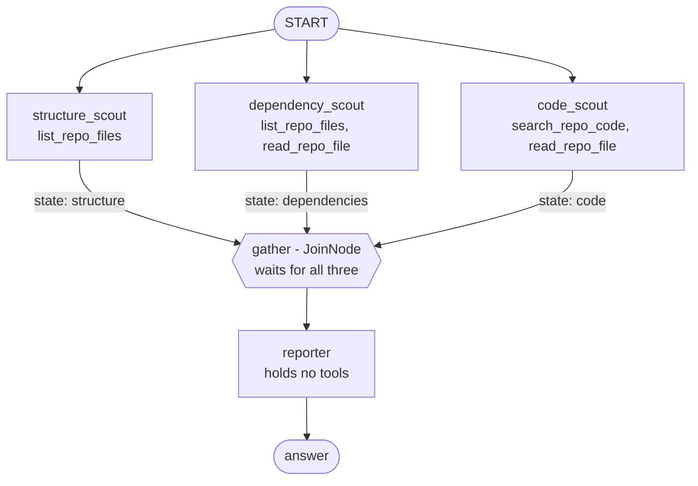

# Atlas

A small team assistant agent, built incrementally as the practice project for the
Agentic AI Developer Program.

**Status: Module 0, plus `code_agent` on branch `TOR-27399`.** This is the project skeleton — the package layout, tooling and
environment are in place. Each module of the program adds
a layer: schemas and async clients, then a single tool-calling agent, then retrieval,
then multiple agents, and so on.

## Requirements

- [uv](https://docs.astral.sh/uv/) — manages the Python version, the virtual
  environment and the dependencies
- A Gemini API key from [Google AI Studio](https://aistudio.google.com/apikey)

You do not need to install Python yourself. uv reads `requires-python` and fetches a
matching interpreter; this project is pinned to 3.12.

## Setup

```bash
git clone https://github.com/rs-piyush-talegaonkar/atlas.git
cd atlas
uv sync
```

`uv sync` creates `.venv` and installs everything from `uv.lock`, so you get the exact
same package versions this was developed against.

Then create your local environment file:

```bash
cp .env.example .env
```

and put your Gemini API key in it. `.env` is git-ignored and must never be committed.

## Commands

| | |
|---|---|
| `uv run pytest` | run the test suite |
| `uv run pytest --cov` | run with coverage |
| `uv run ruff check .` | lint |
| `uv run ruff format .` | format |
| `uv add <package>` | add a dependency and update the lock file |

There is no need to activate the virtual environment — `uv run` executes inside it.

## Layout

```
src/atlas/
├── schemas/   Pydantic models: inputs, outputs, tool results
├── tools/     every network or database call lives here
├── agents/    agent definitions and prompts
└── api/       HTTP layer
tests/         pytest suite
evals/         agent evaluation sets
```

The separation is the point: tools own all I/O, agents own behaviour and prompts, and
schemas define the typed boundary between them. Keeping network calls out of agent
code is what makes the agents testable with a fake model.

## The code agent

`src/atlas/agents/code_agent/` answers questions about a GitHub repository by
reading its code. It is built on [Google ADK](https://adk.dev/) 2.x as a
workflow graph: three scouts gather evidence independently, a join barrier
waits for all of them, and a reporter that holds no tools writes the answer.



The tool split is the design, not decoration. `structure_scout` can only list
directories, `code_scout` can only search and read, and the reporter can fetch
nothing at all - so it cannot cite a file no scout actually opened. That
guarantee is structural rather than a request in a prompt, and
`tests/test_agent_graph.py` asserts it.

Each scout writes its findings to a state key; the reporter reads all three
through `{structure}`, `{dependencies}` and `{code}` in its instruction.

Run it with the ADK dev UI, which renders the graph and every tool call as a
trace you can step through:

```bash
uv run adk web src/atlas/agents --port 8000
```

Configuration lives in `.env` (see `.env.example`):

| variable | purpose |
|---|---|
| `GOOGLE_API_KEY` | Gemini key from Google AI Studio |
| `GITHUB_TOKEN` | fine-grained PAT; Contents and Metadata read-only is enough |
| `GITHUB_REPO` | repository to read, as `owner/name` |
| `ATLAS_MODEL` | model override. Free-tier flash models allow only 20 requests per day, flash-lite 15 per minute |
| `ATLAS_CONCURRENCY` | how many scouts run at once. 1 by default, to stay under the rate limit |

Note that the agent reads the repository's **default branch on GitHub**, not
your local working tree. Unpushed work is invisible to it.

## Learning log

[`LEARNING_LOG.md`](LEARNING_LOG.md) carries the per-module notes — what was built,
what the measurements said, and what went wrong. Model comparisons, token and latency
numbers and cost estimates go there rather than in commit messages.
